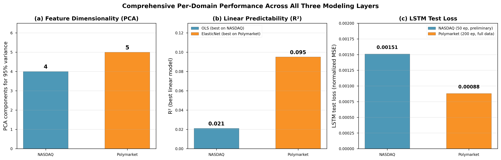

# PolyStock

**Is a binary prediction market simpler to model than the stock market?**

PolyStock compares NASDAQ equities and Polymarket prediction markets as forecasting problems. Both markets get the same engineered feature set (price lags, rolling volatility, cyclical day-of-week encodings), and three models of increasing complexity are run on each:

| Layer | Method | Question it answers |
|---|---|---|
| Unsupervised | PCA | How compressible is each market's feature space? |
| Linear | OLS / Ridge / Lasso / ElasticNet | How much of the target is linearly explainable? |
| Temporal | LSTM (PyTorch) | How much more does sequence memory add? |

The full write-up is in [docs/analysis.md](docs/analysis.md), and [docs/demo.html](docs/demo.html) is an interactive explorer for the PCA, feature, and LSTM results.

## Key findings

| | NASDAQ | Polymarket |
|---|---|---|
| PCA components for 95% variance | 4 | 5 |
| Best linear R² | 0.0212 (OLS) | 0.0951 (ElasticNet) |
| LSTM test MSE (normalized) | 0.00151 | 0.00088 |

- **Dimensionality and predictability are decoupled.** Polymarket needs one *more* principal component than NASDAQ, but it is still the more predictable market. Its bounded yes/no settlement constrains the target, while the inputs stay about as complex as NASDAQ's.
- **Regularization depends on sample size, not on the market.** With about 24M rows, plain OLS does best on NASDAQ. On Polymarket (about 2.6K rows, around 170 polynomial features), OLS overfits badly (R² = −110) and only ElasticNet gets a positive R².
- **LSTMs converge stably on both markets** with no sign of overfitting, even on the small Polymarket dataset.

<p align="center">
  
</p>

## Repository layout

```
├── src/polystock/          # Reusable PCA / dimensionality package
├── scripts/                # CLI entry points for the PCA comparison
├── notebooks/
│   ├── 01_data_cleaning_and_features.ipynb   # Raw data → shared feature set
│   ├── 02_pca_sandbox.ipynb                  # Small-sample PCA smoke test
│   ├── 03_linear_regression.ipynb            # OLS / Ridge / Lasso / ElasticNet
│   ├── 04_lstm_polymarket.ipynb              # LSTM on Polymarket
│   ├── 05_lstm_nasdaq.ipynb                  # LSTM on NASDAQ
│   └── experiments/                          # Early prototypes
├── data/
│   ├── processed/          # Polymarket features (full) + NASDAQ sample
│   └── sandbox/            # Tiny raw samples for quick tests
├── reports/                # JSON outputs from PCA and forecasting runs
└── docs/                   # Write-up, figures, and interactive demo
```

## Getting started

```bash
git clone <this-repo>
cd polystock
python -m venv .venv && source .venv/bin/activate   # Windows: .venv\Scripts\activate
pip install -r requirements.txt
```

### Run the PCA comparison

On the processed datasets (writes `reports/pca_processed_compare.json`):

```bash
python scripts/run_pca_processed_compare.py
```

On any pair of CSVs:

```bash
python scripts/run_pca_compare.py \
  --stock-csv data/sandbox/stocks/demo_stock_aapl.csv \
  --polymarket-csv data/sandbox/polymarket/demo_polymarket_markets.csv \
  --stock-drop-cols Date \
  --out reports/pca_sandbox_result.json
```

Run `python scripts/run_pca_compare.py --help` for scaler, threshold, and drop-column options.

Or use the package directly:

```python
import sys; sys.path.insert(0, "src")
from polystock.dimensionality import compare_domains_pca

result = compare_domains_pca(
    stock_csv_path="data/processed/nasdaq_sample.csv.gz",
    polymarket_csv_path="data/processed/polymarket_cleaned_features.csv",
    variance_threshold=0.95,
)
print(result["comparison"])
```

### Notebooks

Launch Jupyter from the `notebooks/` directory. The notebooks use paths relative to it.

## Data

| Dataset | Source | In repo |
|---|---|---|
| NASDAQ daily OHLCV (5,884 tickers) | [Kaggle: jacksoncrow/stock-market-dataset](https://www.kaggle.com/datasets/jacksoncrow/stock-market-dataset) | Sample only |
| Polymarket market prices | [Kaggle: sandeepkumarfromin/full-market-data-from-polymarket](https://www.kaggle.com/datasets/sandeepkumarfromin/full-market-data-from-polymarket) | Processed features |
| Polymarket market metadata / resolutions | [Kaggle: ismetsemedov/polymarket-prediction-markets](https://www.kaggle.com/datasets/ismetsemedov/polymarket-prediction-markets) | Processed features |

**NASDAQ.** The full processed file (`nasdaq_cleaned_features.csv`, about 6.6 GB) is too large for git. The repo includes `data/processed/nasdaq_sample.csv.gz`, which covers Jan–Feb 2020:

```python
import pandas as pd
df = pd.read_csv("data/processed/nasdaq_sample.csv.gz")
```

To regenerate the full file, download the raw datasets into `data/raw/` and run `notebooks/01_data_cleaning_and_features.ipynb`.

**Polymarket.** The full processed dataset (`data/processed/polymarket_cleaned_features.csv`) is in the repo: 2,582 market-days across 117 resolved markets.

## Tech stack

Python · pandas · NumPy · scikit-learn · PyTorch · matplotlib · Jupyter
