# PolyStock: Dimensionality vs. Predictability in Equity and Prediction Markets

A cross-domain study of NASDAQ equities and Polymarket prediction markets using a shared feature set, PCA, regularized linear regression, and LSTMs.

**Interactive demo:** [demo.html](demo.html)

## 1. Problem Definition
**Business framing:** Financial prediction markets like Polymarket and traditional equity markets like NASDAQ both allow anyone to profit from accurate forecasting, but they differ fundamentally in structure. When traders allocate capital or place bets, the complexity of the signal space directly affects how sophisticated a model needs to be. Our goal is to determine whether Polymarket's binary outcome structure (yes/no) makes it intrinsically lower-dimensional than NASDAQ, and if so, whether simpler models can achieve competitive forecasting performance there. This has practical implications for model selection, compute efficiency, and cross-market signal transfer.

**Technical framing:** We frame both markets as comparable time-series forecasting tasks by engineering a shared feature set (price lags, rolling volatility, and cyclical temporal encodings) applied identically to both domains. We use PCA as an unsupervised dimensionality benchmark to measure intrinsic complexity, LSTM to capture long-term temporal dependencies, and regularized Linear Regression (Ridge, Lasso, ElasticNet) as an interpretable supervised baseline. Models are evaluated on MSE and R² and compared across domains to identify whether predictive signals transfer between markets and whether dimensionality differences translate to measurable performance gaps.

## 2. Introduction & Background

### 2.1 Overview

The stock market and Polymarket both allow anyone to trade on predictions, but they differ fundamentally in structure. Equity markets encode long-term value across dozens of continuous features: price history, volume, volatility, and momentum signals accumulated over decades. Prediction markets encode a single binary outcome: will a specific event happen, yes or no. This structural difference motivates a core question: does Polymarket's binary constraint make it intrinsically lower-dimensional than NASDAQ, and if so, do simpler models generalize better there?

### 2.2 Literature Review

Prior work on stock market prediction has explored a range of ML algorithms including decision trees, random forests, and SVM with various kernels, with RBF-kernel SVM achieving up to 88% prediction accuracy in one comparative study [1]. For prediction markets, recent work using Reinforcement Learning with Verifiable Rewards and LLMs achieved approximately 10% ROI in a Polymarket simulation [2]. Studies have also shown prediction markets outperform professional analysts on company earnings forecasts,  68% accuracy a week out versus 62% for analysts [3]. Suggesting strong latent signal in market prices. Our work extends this literature by directly comparing the intrinsic feature complexity of both domains rather than treating them in isolation.

### 2.3 Dataset Description

**NASDAQ:** Historical daily prices for all current NASDAQ tickers sourced from Kaggle. Features include date, open, high, low, close, adjusted close, and volume. After filtering to 2020-present and removing dead stocks, the dataset contains 24,161,466 ticker-day observations across 5,884 tickers.
- Dataset link: https://www.kaggle.com/datasets/jacksoncrow/stock-market-dataset
- **Why this dataset:** This is the most comprehensive per-ticker OHLC dataset for NASDAQ-listed equities available on Kaggle, covering the full universe of current tickers with daily granularity from 1962 to 2020. The scale (5,884 tickers post-filter) enables robust feature engineering, stable PCA variance decomposition, and large-sample regression without overfitting concerns. Filtering to 2020-present aligns the temporal window with Polymarket's coverage and focuses on the modern liquidity regime.

**Polymarket:** Prediction market data sourced from the Polymarket Gamma API and Kaggle. Raw data consists of 49,429 individual market CSV files with 52 features including OHLC price data, volume metrics, order book data, and holder statistics. After filtering to resolved markets only, the final dataset contains 2,582 market-day observations across 117 resolved markets.
- Dataset link: https://www.kaggle.com/datasets/ismetsemedov/polymarket-prediction-markets
- Dataset link: https://www.kaggle.com/datasets/sandeepkumarfromin/full-market-data-from-polymarket
- **Why this dataset:** This is the only publicly available source of granular, market-level OHLC and order book data for Polymarket at the time of this project. The combination of two Kaggle sources — one providing raw price CSVs and the other providing resolution metadata — was necessary to construct valid prediction targets: without `umaResolutionStatus` from the markets metadata file, there is no way to filter to resolved markets or extract the binary settlement price needed for `Target_Deviation`. No alternative public Polymarket dataset provided both price history and resolution outcomes at this granularity.

The structural difference between the two domains is immediately visible in their price trajectories. NASDAQ prices are continuous, open-ended dollar values that trend over years, while Polymarket prices are bounded probabilities (0–1) that resolve sharply to 0 or 1 at event close.

  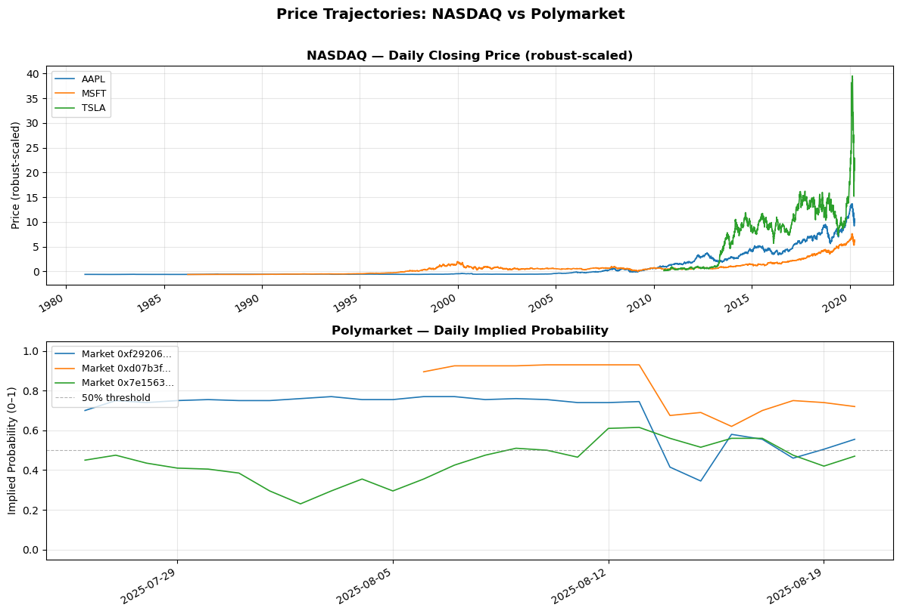
  
<em>Figure 1. Price trajectories for representative NASDAQ tickers (top) and Polymarket prediction markets (bottom). The structural contrast (continuous trending equity prices versus bounded, resolving probability curves) motivates our cross-domain dimensionality comparison.</em>

### 2.4 What Makes This Project Novel

Existing ML work treats stock markets and prediction markets as entirely separate domains. This work frames them as comparable forecasting tasks by engineering a shared feature set applied identically to both, then using PCA as a cross-domain dimensionality benchmark. Rather than optimizing prediction accuracy on a single market, our goal is to quantify whether the structural difference between continuous equity pricing and binary event resolution produces a measurable difference in intrinsic feature complexity, and whether that difference has practical consequences for model selection. This positions our work at the intersection of financial ML and market microstructure analysis, with direct implications for cross-market signal transfer and model efficiency.

Importantly, this project is not a market predictor. We do not optimize for trading returns or forecast absolute prices. Instead we use predictive models as diagnostic instruments, if a simpler model achieves competitive performance on Polymarket relative to NASDAQ, that is structural evidence about the market's intrinsic complexity, not a trading signal. This framing is a deliberate methodological choice: by treating model performance as a proxy for market complexity rather than an end goal, we contribute a transferable framework for comparing any two forecasting domains along a dimensionality axis.

## 3. Methods

### 3.1 Data Preprocessing

#### Overview

Our preprocessing pipeline operates on two heterogeneous financial datasets (NASDAQ historical equity prices and Polymarket prediction market data) and transforms them into a unified, ML-ready format with shared feature representations. The central design challenge is that these datasets differ fundamentally in structure, granularity, and semantics, yet must be made comparable for cross-market dimensionality analysis.

  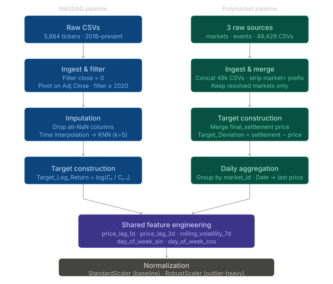
  
<em>Figure 2. End-to-end data preprocessing pipeline for NASDAQ and Polymarket datasets.</em>

---

#### NASDAQ Pipeline

**Ingestion and pivoting.** All per-ticker CSV files from the Kaggle NASDAQ dataset were loaded and concatenated into a master dataframe keyed on `(Date, Ticker)`. The dataset spans 5,884 tickers from 2016 onward. We then pivoted on `Adj Close` to produce a date-indexed matrix of adjusted closing prices, and filtered to dates on or after 2020-01-01 to align with Polymarket's coverage window.

**Dead stock filtering.** Rows where `close <= 0` were dropped before any further computation. Zero-price entries indicate delisted or inactive tickers and would corrupt log-return calculations with undefined values.

**Missing value imputation.** After dropping columns that were entirely NaN, we applied a two-stage imputation strategy. First time-based interpolation (`method='time'`) filled short gaps using temporal continuity, appropriate for financial time series where adjacent observations are closely related. Residual gaps were then filled using KNN imputation (`k=5`), which leverages cross-sectional similarity between tickers to estimate missing values rather than inserting arbitrary constants.

**Target construction.** The prediction target for NASDAQ is log return:

`Target_Log_Return = log(Close_t / Close_{t-1})`

Log returns are preferred over simple returns because they are time-additive, approximately normally distributed, and symmetric around zero (all useful properties for regression and dimensionality analysis). After all filtering and feature construction steps, the final NASDAQ dataset contains **24,161,466 ticker-day observations**.

---

#### Polymarket Pipeline

**Ingestion.** The Polymarket raw data consisted of 49,429 individual CSV files organized by market ID, each containing OHLC price data, volume metrics, and holder statistics sampled at sub-daily frequency. These were loaded with `tqdm`-tracked iteration, tagged with their `market_id`, and concatenated into a single dataframe with 52 columns.

**Market filtering.** We merged the raw price data against `polymarket_markets.csv` to obtain resolution metadata, and retained only markets with `umaResolutionStatus == 'resolved'`. This is critical as unresolved markets have no ground truth settlement price, making target construction impossible.

**Target construction.** The prediction target for Polymarket is probability deviation:

`Target_Deviation = final_settlement − price`

`final_settlement` is extracted from the `outcomePrices` field (parsed from JSON/list format), representing the binary outcome (0 or 1). This deviation measures how far the market's current implied probability was from the true outcome — the core signal for evaluating prediction market efficiency.

**Daily aggregation.** Raw sub-daily records were aggregated to daily granularity by grouping on `(market_id, Date)` and taking the last observed price and summed volume per day, aligning the temporal resolution with the NASDAQ data. After filtering to resolved markets and applying all feature construction steps, the final Polymarket dataset contains **2,582 market-day observations across 117 resolved markets**.

---

#### Dataset Size Asymmetry

The final datasets differ by four orders of magnitude: 24,161,466 NASDAQ ticker-day observations versus 2,582 Polymarket market-day observations. This asymmetry is not a data quality problem — it is a structural property of prediction markets that has direct methodological consequences.

**Why Polymarket is small.** The resolved-market filter is the primary driver. Polymarket markets are short-lived by design: a market on a specific event (e.g., an election outcome, a sports result) opens, trades for days to weeks, and closes when the event resolves. Each market therefore contributes only a small number of daily rows before disappearing. Requiring `umaResolutionStatus == 'resolved'` further excludes any markets still open at data collection time. The result is a dataset that is wide in market diversity (117 distinct events) but shallow in per-market time depth.

**Consequences for modeling.** The size gap rules out naive pooling of both datasets for joint model training — NASDAQ would dominate any shared loss surface. It also means that sequence-based models like LSTM have very short per-market histories to learn from, increasing the risk of overfitting to individual market trajectories. This reinforces the value of our PCA-first approach: dimensionality reduction on the Polymarket feature set is not just useful for comparison, it is practically necessary given that the number of observations (2,582) is not far from the number of features, making high-dimensional models poorly constrained.

**Consequences for interpretation.** PCA results on Polymarket should be interpreted with this sample size in mind. With 117 markets and an average of ~22 daily observations per market, the explained variance estimates are less stable than those from the NASDAQ side. We treat the 1-component dimensionality gap as directionally informative and consistent across our final processed data version, while acknowledging that additional resolved markets entering the dataset over time would be expected to reinforce or sharpen this result.

---

#### Shared Feature Engineering

To frame both markets as comparable forecasting tasks, we constructed a unified set of temporal features applied identically to both datasets:

| Feature | Description |
|---|---|
| `price_lag_1d` | Prior day's price (1-day momentum signal) |
| `price_lag_3d` | Price 3 days prior (short-term trend signal) |
| `rolling_volatility_7d` | 7-day rolling standard deviation of price |
| `day_of_week_sin` | Cyclical sine encoding of day-of-week |
| `day_of_week_cos` | Cyclical cosine encoding of day-of-week |

Cyclical encoding (`sin`/`cos`) is used for day-of-week rather than an integer label because it preserves the circular structure; Monday and Sunday are adjacent in cycle, not 6 units apart. Lag and volatility features were computed within-group (per ticker or per market ID) to prevent look-ahead leakage across instruments.

---

#### Normalization

Two scalers were applied in parallel, producing both versions as separate feature columns:

**StandardScaler (Z-score normalization)** subtracts the mean and divides by standard deviation. This establishes a fair cross-market baseline and is appropriate for PCA, which is sensitive to feature scale.

**RobustScaler** uses median and interquartile range instead of mean and standard deviation. Financial data, especially Polymarket which includes thinly traded markets, contains extreme outliers that would distort StandardScaler estimates. RobustScaler minimizes their influence while preserving relative structure.

Both normalized versions are retained in the final ML-ready dataframes, allowing downstream models to select the scaling regime most appropriate to their assumptions.

---

#### Data Limitations and Mitigations

| Gap | Impact | Mitigation |
|---|---|---|
| No explicit market hours alignment | NASDAQ trades Mon–Fri; Polymarket trades continuously | Both aggregated to daily granularity; cyclical day-of-week encoding captures weekly patterns |
| Polymarket holder/supply data sparse early in market lifecycle | NaN-heavy columns for new markets | Columns not used in shared feature set; kept as supplementary signals |
| No volume normalization across markets of different sizes | Raw `vol_quote` not comparable across markets | RobustScaler applied per dataset; volume used as a feature, not as a cross-market comparison signal |
| Survivorship bias in NASDAQ (only current tickers) | Models may overfit to stocks that survived | Dead stock filter removes zero-price rows; see Limitations in Section 4.4 |
| Severe dataset size asymmetry (24M vs 2.6K rows) | Precludes joint model training; LSTM histories are short | Separate per-domain modeling; PCA used as low-sample-friendly dimensionality benchmark |

### 3.2 PCA

We use PCA as an **unsupervised dimensionality benchmark** to compare whether Polymarket or traditional stock data requires more latent components to explain the same amount of variance. The PCA pipeline is intentionally split across a small package and two command-line entry points so that the logic can be reused both in the report and in ad hoc experiments.

#### File-by-file overview

| File | Role | How it works |
|---|---|---|
| `src/polystock/dimensionality/pca.py` | Core PCA implementation | Loads a CSV, keeps only numeric columns, optionally drops identifier/date fields, imputes missing values with the median, scales features, fits PCA, and computes how many principal components are needed to reach the variance threshold. It also ranks features by weighted absolute PCA loadings so we can interpret what drives the variance structure. |
| `src/polystock/dimensionality/__init__.py` | Public package interface | Re-exports `run_domain_pca` and `compare_domains_pca`, which makes the PCA logic importable from the package without exposing internal helper details. |
| `scripts/run_pca_compare.py` | Generic CLI | Provides a flexible command-line wrapper for any stock and Polymarket CSV pair. It parses arguments, forwards them into the comparison function, and optionally writes the result to JSON. |
| `scripts/run_pca_processed_compare.py` | Project-default CLI | Runs the comparison on the processed datasets used throughout this analysis, applies the project's default drop columns, and writes the canonical output to `reports/pca_processed_compare.json`. |

#### PCA workflow

The implementation in `pca.py` follows a consistent sequence:

1. **Select usable features.** `prepare_numeric_features()` removes any requested metadata columns such as `date`, `ticker`, or `market_id`, then keeps only numeric columns so PCA receives a valid feature matrix.
2. **Impute missing values.** `build_preprocess_pipeline()` inserts a median `SimpleImputer`, which is robust to missing values and avoids dropping rows unnecessarily.
3. **Normalize the data.** The same pipeline applies either `StandardScaler` or `RobustScaler`. Standard scaling centers each feature at zero mean and unit variance, while robust scaling uses median and interquartile range, which is better for noisy financial series with outliers.
4. **Fit PCA.** `run_domain_pca()` fits PCA on the transformed matrix and computes cumulative explained variance.
5. **Measure intrinsic dimensionality.** `components_for_variance()` finds the smallest number of components whose cumulative explained variance reaches the threshold, which is set to 95% in this project.
6. **Interpret the components.** `compute_feature_scores()` aggregates absolute PCA loadings weighted by explained variance so we can rank the original features by influence.
7. **Compare domains.** `compare_domains_pca()` runs the same procedure for stock and Polymarket, then reports which domain is lower-dimensional and by how many components.

#### Overview in context

Final processed-data run (`reports/pca_processed_compare.json`) shows:
- Stock reaches 95% explained variance in **4** components.
- Polymarket reaches 95% explained variance in **5** components.
- Polymarket requires one additional principal component, indicating slightly higher dimensionality under this shared feature set.

For a deeper insight into results, see section 4.1.

### 3.3 LSTM

LSTM networks are a type of supervised learning model, built using Recurrent Neural Networks (RNNs). They are used to make time series forecasting predictions of sequential data using long-term dependencies. For this project, LSTM is used for both stock market data and polymarket data, since both involve sequential, time-stamped data where the goal is to predict future prices. For the LSTM model using Polymarket data, the code can be found in [`notebooks/04_lstm_polymarket.ipynb`](../notebooks/04_lstm_polymarket.ipynb). For the LSTM model using Nasdaq/stock market data, the code can be found in [`notebooks/05_lstm_nasdaq.ipynb`](../notebooks/05_lstm_nasdaq.ipynb).

The code for both sets of data is nearly identical. The only difference lies in how the data is inputted and outputted. Each contains different features that need to be separately filtered, and each produces slightly different results, with stock market data focusing on returning price (the `price` feature) and polymarket data focusing on returning the target log return (the `Target_Log_Return` feature). Other than hyperparameter tuning differences, number of features, and length of sequences, the LSTM model works identically for both datasets.

The code consists of multiple steps from start to finish. First, the various packages and libraries needed for the code to run are imported. PyTorch was the main package used to implement the actual LSTM model. Pandas was used for dataset implementation. NumPy was used for fast calculations and matrix manipulation. sklearn was used for the normalization of the data. Next, the dataset needs to be inputted, along with performing some data preprocessing to get the data ready for what the model needs. This includes selecting the desired features to be inputted into the LSTM model, splitting the data into training and testing data (the code used an 80%/20% split for training data and testing data), and normalizing the data. Afterwards, the various values for the model parameters and hyperparameters were selected. Following that, the LSTM model itself was created. This included choosing Mean Squared Error as the metric to determine the loss of the model, as well as including Adaptive Moment Estimation (Adam), a dropout proportion, splitting the data into batches and epochs, and other characteristics. The next step of the model is to finalize the data and needed inputs for the LSTM model to run, like splitting the data into time sequences for each ticker (`ticker`) or market ID (`market_id`). Then, the model undergoes its training, where every 10 epochs are kept track of and recorded, each step also recording the current training and test loss metric. Once the model is finished with its training, predictions can then be made. There are functions that can make a prediction based on any inputted time sequence, forecasting the future for the entire inputted dataset, as well as the ability to input an external dataset to generate predictions for those pieces of data.

Both LSTM implementations converge stably on their respective datasets. On Polymarket, the model reaches a final test MSE of 0.00081 after 200 training epochs with no overfitting signature; on NASDAQ, it reaches a final test MSE of 0.00151 after 50 epochs. Full quantitative results, training curves, and seven-day autoregressive forecasts are reported in Section 4.2.

### 3.4 Linear Regression

We use regularized linear regression as an **interpretable supervised baseline** to determine how well engineered features linearly map to future returns and price deviations. By comparing Ordinary Least Squares (OLS) against regularized variants—Ridge, Lasso, and ElasticNet—we can diagnose whether the feature space is over-specified and identify which specific indicators drive predictive power in each market.

#### Regression Workflow

The implementation follows a rigorous pipeline designed for cross-market comparability:

1.  **Preprocessing and Transformation:** The pipeline constructs a sequence that includes median imputation for missing data and standard scaling. To capture potential non-linear relationships, such as $Volume \times Volatility$, the system supports optional polynomial feature expansion.
2.  **Automated Hyperparameter Tuning:** For Ridge, Lasso, and ElasticNet, we implement automated selection using 10-fold cross-validation to optimize regularization strength and prevent overfitting.
    * **Ridge/Lasso:** Evaluates a broad range of 150 log-spaced alpha values.
    * **ElasticNet:** Simultaneously tunes the penalty (alpha) and the mixing ratio (L1-ratio) across 250 configurations.
3.  **Model Fitting and Prediction:** Models are trained on 80% of the data and evaluated on a 20% held-out test set to ensure the results generalize across different time periods.
4.  **Evaluation Metrics:** The system outputs performance metrics including Mean Squared Error (MSE), Root Mean Squared Error (RMSE), and R-squared ($R^2$) to facilitate a quantitative comparison.
5.  **Cross-Market Comparison:** By running identical procedures for both NASDAQ and Polymarket, we identify the "best" model for each domain and assess the relative signal predictability across markets.

#### Overview in Context

Results from the final analysis indicate significant differences in market predictability:
* **NASDAQ Best Model:** **OLS** reached an $R^2 \approx 0.0212$.
* **Polymarket Best Model:** **ElasticNet** achieved a significantly higher $R^2 \approx 0.0951$.
* **Predictability Gap:** Polymarket exhibits a higher $R^2$ than NASDAQ, suggesting that while the stock market is more efficient and harder to predict linearly, prediction market outcomes are more strongly correlated with our engineered feature set.

For a deeper insight into results, see section 4.3.

### 3.5 Model Comparison

We use a three-tier framework to evaluate the relationship between dimensionality and predictability across markets. This framework includes unsupervised dimensionality analysis, interpretable linear baselines, and advanced temporal modeling. PCA, regularized Linear Regression, and LSTM—are not competing alternatives but a deliberately chosen ladder of model complexity applied identically to both domains. Linear Regression introduces supervision while remaining structurally simple and fully interpretable. LSTM adds temporal memory and non-linear capacity at the cost of interpretability. Comparing how each domain's predictability evolves as we move up this ladder is the core of our cross-market analysis.

- **Unsupervised Dimensionality Benchmark (PCA).** PCA serves as our primary tool for measuring intrinsic feature complexity without reference to prediction targets. We establish a baseline dimensionality estimate for each market. This unsupervised approach is particularly valuable given the severe dataset size asymmetry, as PCA does not require large sample sizes to produce stable variance decompositions.

- **Supervised Linear Baseline (Regularized Regression).** We use linear regression models (OLS, Ridge, Lasso, ElasticNet) as an interpretable supervised baseline. They test if our features have a linear mapping to future returns. We compare regularized and unregularized models to check the overfitting risk. It also shows which market needs feature selection more. 

- **Temporal Deep Learning (LSTM).** LSTM networks can capture long-term dependencies that linear models cannot handle. We compare LSTM with linear baselines to see the extra value of temporal modeling. If LSTM is much better than linear regression on both markets, it means time-series complexity is the main difficulty for prediction, not static dimensionality.

**Cross-Model Evaluation Metrics** 

For all supervised models we use a consistent train/test split and report both Mean Squared Error (MSE) and the coefficient of determination (R²) [4]. R² is the primary cross-domain metric in this analysis because MSE is sensitive to target scale: NASDAQ's `Target_Log_Return` and Polymarket's `Target_Deviation` differ by roughly an order of magnitude in standard deviation. So MSE values are not compared directly between domains. R², being a unitless ratio of explained to total variance, is scale-invariant and therefore the appropriate diagnostic for our central question of whether the engineered feature set carries more predictive signal in one market than the other.

A consistent framework lets us read PCA, Linear Regression, and LSTM as three views of the same underlying question: how much structure does each market carry, and at what model complexity does that structure become accessible? PCA answers the unsupervised side (how compressible is the feature space). Linear Regression answers the simple-supervised side (how much variance is linearly explainable). LSTM answers the complex-supervised side (how much additional signal is unlocked by temporal memory). A coherent picture across the three is stronger evidence than any one of them alone.

An interactive demo of the PolyStock models — including live LSTM forecasts and PCA visualizations for both markets — is available at: [**PolyStock Interactive Demo**](demo.html)

## 4. Results and Discussion

### 4.1 PCA Results and Visual Analysis

We evaluate intrinsic dimensionality using cumulative explained variance from PCA with a 95% threshold. Figures below are generated from `reports/pca_processed_compare.json`.

Key quantitative outputs:
- NASDAQ reaches 95% explained variance in 4 components.
- Polymarket reaches 95% explained variance in 5 components.
- The final processed feature set confirms a consistent 1-component dimensionality gap between domains.

  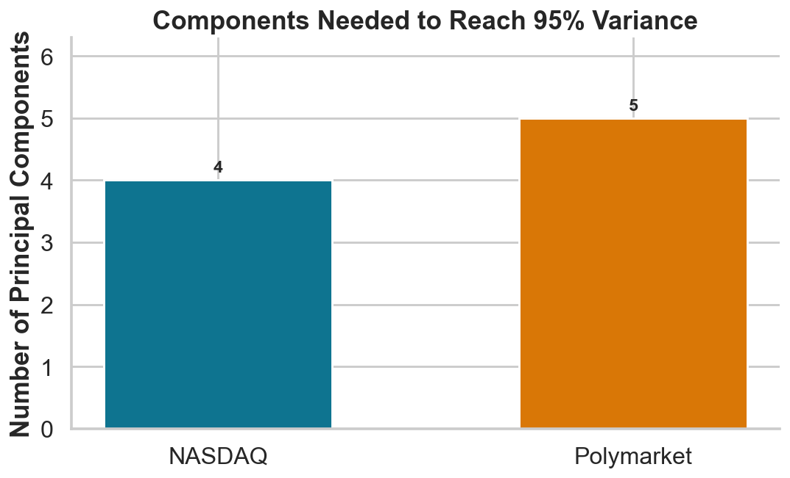
  
<em>Figure 3. Number of principal components needed to reach 95% explained variance for each domain.</em>

  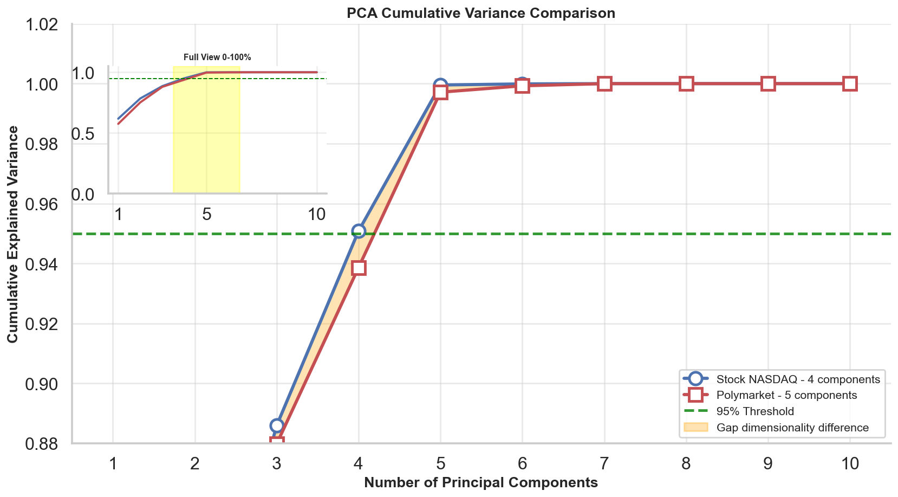
  
<em>Figure 4. Cumulative explained variance comparison with adjusted y-axis highlighting the 95% threshold crossing difference (PC=4 vs PC=5)</em>

Interpretation:
- Both datasets are strongly compressible (few PCs explain most variance), but Polymarket requires one additional component.
- The difference is small but consistent with our final data version and preprocessing configuration.
- These results confirm that both markets compress strongly under the shared feature set, and that the dimensionality gap is a stable property of the feature geometry rather than a preprocessing artifact.

Feature-level interpretability:
<table>
  <tr>
    <td>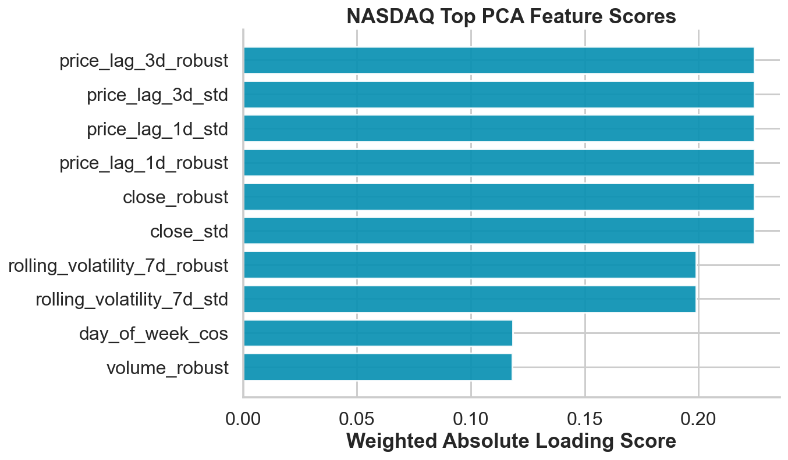 <em>Figure 5. NASDAQ top weighted absolute PCA loading scores.</em></td>
    <td>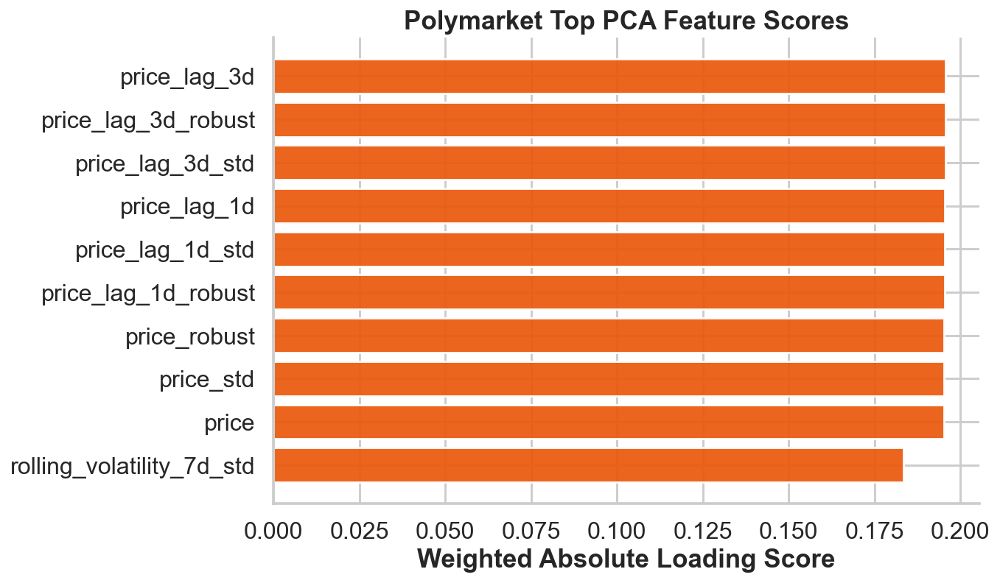 <em>Figure 6. Polymarket top weighted absolute PCA loading scores.</em></td>
  </tr>
</table>

From Figures 5 and 6, lag-based and volatility-related features dominate both domains, supporting our design choice to frame stock and prediction markets as comparable time-dependent forecasting settings.

### 4.2 LSTM Results

We evaluate LSTM performance on both markets using identical architectures (3-layer LSTM with 256 hidden units, dropout=0.2, sequence length=5 days) to ensure fair comparison. Training was conducted for 200 epochs with learning rate 0.0001 and batch size 32.

#### Training Dynamics

  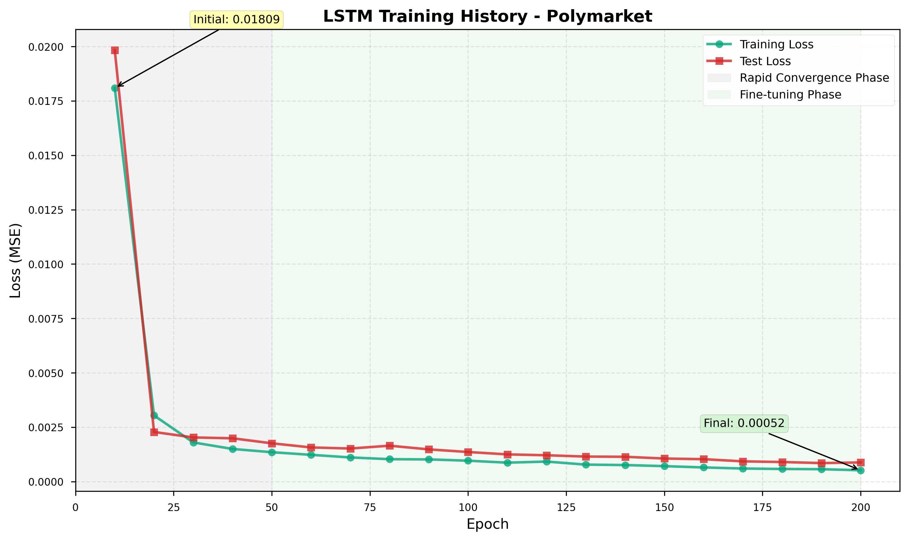
  
<em>Figure 7. LSTM training history on Polymarket data showing rapid initial convergence followed by gradual refinement over 200 epochs.</em>

Figure 7 illustrates the training dynamics on Polymarket data. The model exhibits rapid convergence in the first 20 epochs, with training loss dropping from 0.018 to 0.003 (83% reduction). This fast initial convergence is characteristic of well-initialized deep learning models with appropriate hyperparameters. The subsequent 180 epochs demonstrate gradual refinement, with both training and test loss continuing to decrease in parallel.

**Key Observations:**

- **No Overfitting:** Training and test loss curves remain closely aligned throughout training on both markets. The dropout layer (p=0.2) and the modest sequence length (5 days) successfully prevent overfitting despite the small Polymarket sample size.
- **Two-Phase Convergence (Polymarket):** The majority of learning occurs in the first 50 epochs. Epochs 50–200 provide incremental refinement — typical for Adam optimizer with adaptive learning rates.
- **Convergence Quality (Polymarket):** Final training loss (0.00052) and test loss (0.00088) on the normalized feature scale are both very low, suggesting the model has captured meaningful temporal patterns rather than memorizing noise.

#### Quantitative Performance

| Market         | Train Loss | Test Loss | Input Features | Sequence Length | Total Epochs |
| -------------- | ---------- | --------- | -------------- | --------------- | ------------ |
| **Polymarket** | 0.00052    | 0.00088   | 19             | 5 days          | 200          |
| **NASDAQ**\*   | 0.00382    | 0.00151   | 13             | 5 days          | 50           |

#### Prediction Quality

  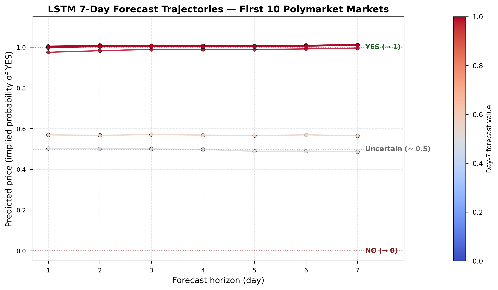
  
<em>Figure 8. Seven-day autoregressive LSTM forecasts for the first ten Polymarket markets, colored by their Day-7 terminal value. Reference lines indicate the binary settlement attractors (1.0 = YES, 0.0 = NO) and the maximum-uncertainty point (0.5). Several trajectories slightly exceed 1.0 in later days; this reflects the unconstrained linear output combined with MinMax inverse-scaling, and is a property of the architecture rather than a forecast error.</em>

As in this figure, eight of the ten trajectories produce stable forecasts near 1.0, indicating high model confidence in a YES resolution. The remaining two markets (markers near 0.50 and 0.57) show essentially flat trajectories close to the 0.5 line — the LSTM's signature for maximum uncertainty about the binary outcome. Across the full 117-market dataset, the top five predicted price increases ranged from +0.049 to +0.096 over the seven-day horizon.

**Summary:** LSTM training converges stably with no overfitting signature on both markets, demonstrating that temporal modeling is feasible at this model capacity for both equity and prediction-market data. The Polymarket result, in particular, validates that LSTM can capture meaningful sequence structure even on a small dataset when properly regularized via dropout and limited sequence length.

### 4.3 Linear Regression Results

We evaluate four linear regression variants (OLS, Ridge, Lasso, ElasticNet) on both markets using identical preprocessing pipelines (median imputation, standard scaling, polynomial features with degree=2) and 10-fold cross-validation for hyperparameter tuning.

#### NASDAQ Results

| Model      | MSE        | R²         | Alpha | Interpretation                                               |
| ---------- | ---------- | ---------- | ----- | ------------------------------------------------------------ |
| **OLS**    | **0.0235** | **0.0212** | N/A   | **Best performer**; large sample provides sufficient constraint |
| Ridge      | 0.0240     | 0.0001     | 4.76  | Regularization slightly degrades performance                 |
| Lasso      | 0.0240     | -0.0000    | 100.0 | Feature selection too aggressive; performs at baseline       |
| ElasticNet | 0.0240     | -0.0000    | 100.0 | Combined penalty offers no advantage over OLS                |

**Summary:** On NASDAQ's large sample (386,583 training observations after the 80/20 split), simple OLS achieves the best R² = 0.0212. Regularization methods (Ridge/Lasso/ElasticNet) slightly degrade performance, indicating that the large sample size already provides sufficient constraint against overfitting. The near-zero R² values across all variants suggest that linear models, regardless of regularization, struggle to capture the complex non-linear dynamics of stock price movements.

#### Polymarket Results

| Model          | MSE        | R²         | Alpha  | Interpretation                                               |
| -------------- | ---------- | ---------- | ------ | ------------------------------------------------------------ |
| OLS            | 7.085      | -110.32    | N/A    | Catastrophic overfitting; far worse than predicting the mean |
| Ridge          | 0.322      | -4.06      | 3137.9 | Strong L2 penalty reduces overfitting but still negative     |
| Lasso          | 0.064      | -0.0004    | 100.0  | L1 feature selection brings R² back to baseline              |
| **ElasticNet** | **0.0576** | **0.0951** | 0.1    | **Best performer**; L1+L2 combination unlocks linear signal  |

**Summary:** On Polymarket's small sample (2,065 training observations), OLS catastrophically overfits with R² = -110.3 — orders of magnitude worse than a constant-mean baseline. Polynomial expansion of 17 base features yields ~170 derived parameters, which OLS cannot constrain on this sample size. ElasticNet, combining L1 (sparsity) and L2 (shrinkage) penalties with α = 0.1, recovers R² = 0.0951.

#### Cross-Domain Regularization Behavior

  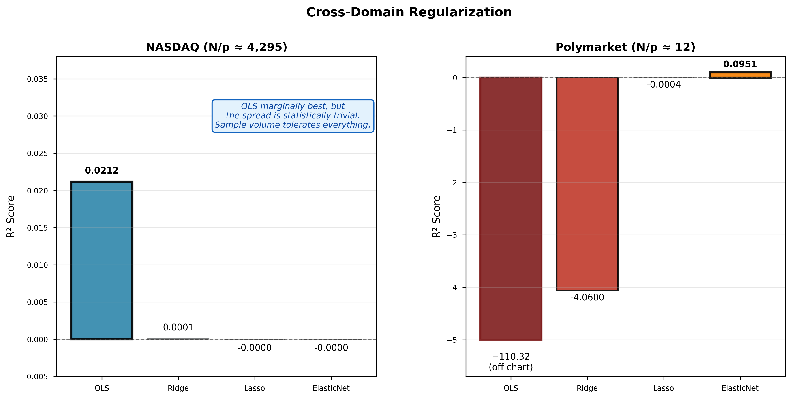
  
<em>Figure 9. R² of the four linear variants on each domain, plotted with domain-specific y-axes to expose the within-domain story. Left: on NASDAQ, all four models converge to R² ≈ 0–0.02; OLS marginally wins, but the spread is statistically trivial and regularization brings no benefit. Right: on Polymarket, R² ranges from -110 (OLS, off-chart) up to +0.0951 (ElasticNet); only sparsity-inducing L1+L2 regularization recovers a positive R².</em>

Figure 9 visualizes the cross-domain regularization asymmetry across the four linear variants. The two panels deliberately use different y-axis ranges, because the regularization regimes on the two domains are fundamentally incommensurate in scale — and that incommensurability is itself the central finding. On NASDAQ, the four models cluster within a 0.02 R² band; on Polymarket, they span more than 110 R² units between OLS and ElasticNet.

### 4.4 Model Comparison

We now synthesize results across all three modeling tiers to address our core research question: does Polymarket's binary structure make it intrinsically lower-dimensional than NASDAQ, and do simpler models achieve competitive performance there?

#### Three-Tier Results Summary

| View                            | NASDAQ  | Polymarket | Direction                  |
| ------------------------------- | ------- | ---------- | -------------------------- |
| PCA components for 95% variance | 4       | 5          | Polymarket slightly higher |
| Best Linear R²                  | 0.0212  | 0.0951     | Polymarket clearly higher  |
| LSTM normalized test MSE        | 0.00151 | 0.00088    | Polymarket lower           |

  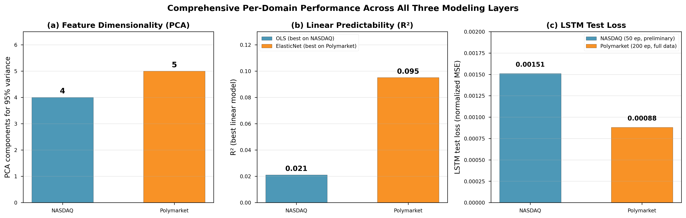
  
<em>Figure 10. Side-by-side summary across the three modeling layers. (a) PCA components needed to reach 95% explained variance. (b) Best linear-regression R² in each domain. (c) LSTM test loss on MinMax-normalized features. The two supervised metrics agree that the engineered feature set carries more predictive signal on Polymarket than on NASDAQ.</em>

The figure unifies the three modeling tiers. PCA suggests that, in the engineered feature space, Polymarket is *not* uniformly lower-dimensional than NASDAQ — it requires one additional component to reach the same explained-variance threshold. However, both supervised models (linear and LSTM) find Polymarket more *predictable* relative to its own variance. These two findings are reconcilable rather than contradictory.

#### Decoupling of Feature Dimensionality and Target Predictability

  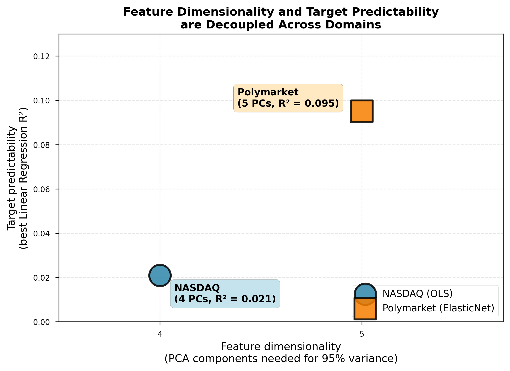
  
<em>Figure 11. Feature-space dimensionality (PCA components for 95% variance) plotted against target-space predictability (best linear R²) for each domain. Polymarket exhibits both higher feature dimensionality and higher linear predictability than NASDAQ, illustrating that the two quantities measure different aspects of market structure: the feature manifold and the target signal.</em>

As shown in this figure, it makes the decoupling explicit. If feature-space dimensionality were the dominant determinant of how learnable a market is, NASDAQ — being the lower-dimensional domain — should yield the higher R². Instead the opposite holds. The most parsimonious explanation is that:

- **PCA Dimensionality** captures how many directions are needed to describe variation in the input features (e.g., correlation among `price_lag_1d` and `price_lag_3d`).
- **Target Predictability** captures how much of the target's variance can be explained from those features (a function of the target's own structure, not just the inputs).

These are different quantities, and a market can have a slightly richer feature manifold while still having a strongly constrained target structure — which is exactly what binary-resolved prediction markets produce. Polymarket's binary settlement compresses *target* variance in a way that lag-and-volatility features partially capture; NASDAQ's continuous log-return target retains residual variance that no linear projection of the same features can recover.

#### Tradeoffs Across Modeling Tiers

The three modeling tiers serve complementary roles. No single tier dominates; each is suited to a different diagnostic question.

| Method                        | Strengths                                                   | Limitations                                                                  |
| ----------------------------- | ----------------------------------------------------------- | ---------------------------------------------------------------------------- |
| PCA                           | Stable on small samples; unsupervised; interpretable loadings | No prediction signal; captures only linear correlations among features       |
| Linear Regression (regularized) | Interpretable coefficients; fast; well-understood theory   | R² < 0.1 on both markets; cannot capture non-linear or temporal dynamics     |
| LSTM                          | Captures temporal sequence dependencies; converges stably  | Black-box; ~1M parameters; outputs not on the same scale as the LR target    |

The choice between them is therefore not "which is best" but "which question are we answering": PCA for feature-space compressibility, Linear Regression for static linear predictability, LSTM for temporal dynamics.

#### Limitations

Data limitations:
- Polymarket sample size. Only 117 resolved markets with 2,582 observations. As more markets resolve over time, both PCA loadings and linear R² estimates will stabilize.
- Survivorship bias. NASDAQ data includes only currently listed tickers, excluding delisted stocks. This may inflate apparent predictability.
- No external features. We use only price-derived technical indicators. Adding news sentiment or macroeconomic variables could improve performance.

Model limitations:

LSTM predicts the full feature vector at the next step on a normalized scale, while linear regression predicts the raw target. Direct numerical comparison between LSTM test loss and linear regression MSE is therefore qualitative, not quantitative. Hyperparameter coverage. LSTM hyperparameters were not tuned via cross-validation due to compute constraints.

#### Conclusion

This study demonstrates that intrinsic feature dimensionality does not directly predict forecasting difficulty in financial time series. Despite NASDAQ requiring
fewer principal components, it does not exhibit superior predictability under linear models — the opposite holds (R²). In other words, the "easier to predict" property of Polymarket comes from its bounded yes/no outcome — not from any simplification in the input features themselves.

Across the three modeling tiers, three takeaways emerge: (i) feature dimensionality and target predictability are decoupled diagnostics that should be reported
separately; (ii) regularization need is determined by the sample-to-parameter ratio, not by market structure — NASDAQ's data abundance tolerates OLS while
Polymarket's scarcity demands ElasticNet; and (iii) temporal modeling adds value beyond static linear features on both markets, though direct quantitative
comparison with linear regression is limited by differing prediction targets and scales.

These findings suggest that practitioners working at the intersection of equity and prediction markets should treat dimensionality and predictability as separate
diagnostics, choose regularization strategies based on sample size, and not assume that "lower-dimensional" implies "easier to forecast."

An interactive demo of the PolyStock models — including live LSTM forecasts and PCA visualizations for both markets — is available at: [**PolyStock Interactive Demo**](demo.html)

### 4.5 Next Steps

These results establish a cross-domain dimensionality and predictability baseline, but several natural extensions would deepen or stress-test these findings.

- **Expand the Polymarket dataset.** The resolved-market filter limits the current dataset to 117 markets and 2,582 observations. As more Polymarket events resolve, expanding the dataset would stabilize PCA variance estimates, provide longer per-market LSTM histories, and reduce the risk of overfitting in the polynomial regression setting.

- **Matched LSTM training budgets.** NASDAQ was trained for 50 epochs versus 200 for Polymarket, due to per-ticker sequence count differences. Running the NASDAQ LSTM to the same epoch budget would provide a fairer test-loss comparison and may close some of the MSE gap attributed to domain differences rather than training time.

- **Non-linear dimensionality reduction.** PCA assumes linear structure. Applying Isomap [5] or UMAP would test whether the 1-component dimensionality difference between markets is robust to non-linear feature geometry, or whether it is an artifact of the linear projection assumption.

- **Sparse PCA for interpretability.** Standard PCA produces dense loading vectors across all features. Applying Sparse PCA [6] would constrain each component to a small subset of features, producing more interpretable principal directions and clarifying which specific market signals drive the dimensionality gap.

- **Cross-market feature transfer.** Train a model on NASDAQ features and evaluate zero-shot on Polymarket targets, and vice versa. If the shared lag-and-volatility feature set captures universal market dynamics, cross-market generalization should be non-trivially above a constant-mean baseline.

- **Trading simulation backtest.** Translate the Polymarket ElasticNet signal (R²=0.0951) into a paper-trading backtest to assess whether the linear predictability maps to risk-adjusted returns above a buy-and-hold baseline. This would bridge the diagnostic framing of this project toward a practical application.

- **Transformer-based temporal modeling.** Replace the LSTM with a temporal fusion transformer or self-attention architecture to assess whether attention mechanisms unlock additional long-range dependencies that the LSTM's fixed-window recurrence misses, particularly on the longer NASDAQ ticker histories.

## 5. References

[1] A. Chakravorty and N. Elsayed, "A Comparative Study of Machine Learning Algorithms for Stock Price Prediction Using Insider Trading Data," *arXiv.org*, 2025. [Online]. Available: https://arxiv.org/html/2502.08728v1. [Accessed February 23, 2026].

[2] B. Turtel, D. Franklin, K. Skotheim, L. Hewitt, and P. Schoenegger, "Outcome-based Reinforcement Learning to Predict the Future," *arXiv.org*, 2025. [Online]. Available: https://arxiv.org/pdf/2505.17989. [Accessed February 23, 2026].

[3] G. McCubbing, "Can Polymarket-style prediction markets beat analysts this earnings season? Polymarket thinks so," *Australian Financial Review*, February 4, 2026. [Online]. Available: https://www.afr.com/markets/equity-markets/can-prediction-markets-beat-analysts-this-earnings-season-20260202-p5nyul. [Accessed February 23, 2026].

[4] Scikit-learn developers, "3.4. Metrics and scoring: quantifying the quality of predictions," *scikit-learn 1.8.0 documentation*. [Online]. Available: https://scikit-learn.org/stable/modules/model_evaluation.html. [Accessed February 26, 2026].

[5] J. B. Tenenbaum, V. de Silva, and J. C. Langford, "A global geometric framework for nonlinear dimensionality reduction," *Science*, vol. 290, pp. 2319–2323, 2000. [Online]. Available: https://www.robots.ox.ac.uk/~az/lectures/ml/tenenbaum-isomap-Science2000.pdf. [Accessed February 26, 2026].

[6] H. Zou, T. Hastie, and R. Tibshirani, "Sparse principal component analysis," *Journal of Computational and Graphical Statistics*, vol. 15, no. 2, pp. 265–286, 2006. [Online]. Available: https://hastie.su.domains/Papers/spc_jcgs.pdf. [Accessed February 26, 2026].
